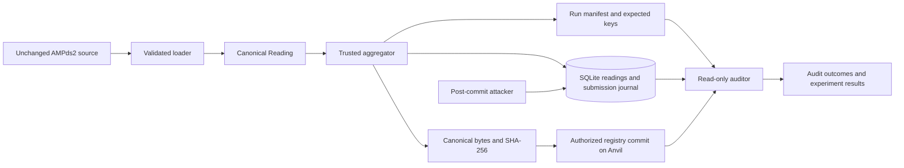

# Design: Smart-meter integrity auditing

Status: target design, not a description of completed implementation.  
Baseline inspection: 2026-10-15.  
Companion documents: [Requirements](requirements.md) · [Tasks](tasks.md)

## 1. Repository baseline

The repository already has the right separation between data loading, fingerprinting, storage, blockchain access and auditing. Keep that structure and complete it incrementally.

| Inspected area | Current evidence | Design response |
| --- | --- | --- |
| `contracts/src/MeterCommitmentRegistry.sol` | Interface and role constant exist; three core methods revert with TODO | Implement the existing ABI, add explicit nonzero-admin validation |
| Contract tests | Seven named tests call `vm.skip(true)` | Implement assertions, then extend role, fuzz and invariant coverage |
| `fingerprint`, `dataset`, `aggregator`, `verifier` | Core functions raise `NotImplementedError` | Implement behind their current module boundaries |
| `models.py`, `db.py` | Five-field reading, three verdicts, unique SQLite identity | Retain reading fields; extend verdict/results and add submission journal/migrations |
| `chain.py` | Connects, signs and returns receipt status | Validate context; preserve transaction evidence; handle rejected, reverted and uncertain outcomes separately |
| `demo.py` | Deletes configured DB; later audits only surviving DB keys | Use run directories and manifest-driven audits with safe resume |
| Python tests | Nine fingerprint examples; five attack tests skipped | Retain meaningful assertions and build the missing layers |
| Tooling | README calls `make`; Makefile and CI absent; dependency versions are lower bounds | Add reproducible commands and required verification jobs |
| Data | Both source CSVs exist under `data/raw/` | Document and use explicit adapters; do not download duplicate copies |
| Documentation | Build guide is local/ignored; some comments overstate hash guarantees | Make tracked README/specs sufficient; correct stale claims during implementation |

This inspection did not execute or certify the application. No implementation task is marked complete just because a stub or helper exists. Changes to scaffold interfaces below are deliberate design proposals to implement in the listed task groups.

## 2. Architecture and trust boundaries



The attack fixtures alter the readings table. The manifest and chain remain outside that attack. Role tests use separate accounts. Anvil and all experiment files remain under the operator's overall control; this does not simulate independent institutions.

No RPC server, dashboard, remote database or public wallet is needed. SQLite is sufficient for a serial classroom experiment. A single writer keeps nonce management and recovery understandable. Tests must verify that this restriction is enforced.

### Module responsibilities

| Module/path | Responsibility |
| --- | --- |
| `models.py` | Reading, audit outcome/result, ingestion summary and typed domain errors |
| `dataset.py` | Explicit source adapter, timestamp parsing, interval validation, deterministic Wh conversion |
| `fingerprint.py` | Pure canonical representation, record key and digest |
| `db.py` | Parameterized queries, schema versions, persistence and journal transactions |
| `chain.py` | Connection/context validation, read calls, signing, receipts and failure classification |
| `aggregator.py` | Validate, prepare, submit, confirm and reconcile |
| `verifier.py` | Read-only per-key and manifest audits |
| `results.py` | Structured result records, CSV export and useful diagnostics |
| `demo.py` | CLI orchestration of a new run, resume and audit |
| `evaluate.py` (new) | Summaries and scenario metrics from recorded evidence |
| `runs.py` (new if needed) | Run directory, manifest, deployment identity and single-writer lock |
| `contracts/src/...sol` | Role-controlled append-once digest registry |
| `pipeline/tests/fixtures/` | Small, synthetic, tracked CSVs and fixed encoding vectors |
| `results/<run_id>/` | Local generated manifests, database and results; curated evidence may go in `results/final/` |

Prefer small functions and typed interfaces. Do not add generic repository frameworks, web APIs or a service layer that the CLI does not need.

## 3. Data interpretation and conversion

### Source contract

Observed headers, not yet a substitute for a source-backed dictionary:

```text
Electricity_WHE.csv: unix_ts,V,I,f,DPF,APF,P,Pt,Q,Qt,S,St
Electricity_P.csv:   UNIX_TS,WHE,RSE,...
```

Use the WHE file's `unix_ts` and `P` initially. Task 1 must confirm Unix seconds, real power in W, sampling interval and imputation convention from the dataset paper/metadata. Record exact source locations in `docs/DATA_DICTIONARY.md`. Do not infer `Pt` units or use it as a cumulative energy counter without separate verification. The alternative P-file adapter is optional; merely finding a numeric column is insufficient.

Preserve source text when reading timestamps. If the documented leading `+` marks imputation, strip it only after recording the flag. Retain those samples under the initial policy, count them per interval/run and state that choice. Do not quietly interpolate additional missing minutes.

### Deterministic transformation

1. Stream rows in original order; validate the selected range. Accept integer Unix seconds with an optional documented imputation prefix. Never interpret naive timestamps in the host timezone.
2. Use UTC hour boundaries `[start, start + 3600 seconds)`. Selected timestamps must align to whole minutes. Reject duplicate, reversed or internally missing timestamps.
3. Exclude incomplete edge hours, recording their rows/counts. Every emitted hour must have exactly 60 valid samples. Stop after the configured positive limit of emitted hours; do not claim the remainder of an unscanned source was validated.
4. Parse power as exact decimal/rational values, not binary floats. With confirmed W inputs, calculate `energy_Wh = sum(P_W) / 60`. Round the complete interval once, half up, to a nonnegative integer. Do not round individual samples first. Reject non-finite values and negatives for this consumption-only adapter.
5. Produce `Reading(meter_id, interval_start, value_wh, "Wh", seq)`. `interval_start` is `YYYY-MM-DDTHH:00:00Z`; `seq` starts at zero for the first retained hour of the fixed selected range. Resume uses the same selection and preserves this sequence.

Examples for synthetic tests: 60 samples at 60 W yield 60 Wh; 60 samples at 0.5 W yield 1 Wh under the chosen rounding; the last minute of one hour belongs to that hour and the next whole hour starts a new interval. The maximum rounding error is 0.5 Wh per retained interval, separate from the measurement/integration approximation.

The existing `interval_minutes` argument remains for compatibility but initially accepts only 60. Additional intervals require updating this specification, manifests and tests. Fixed run configuration prevents two meanings for the same meter/time identity in one registry. No mathematical power limit is invented; plausibility checks beyond the selected source's documented range remain descriptive.

## 4. Reading model and canonical wire format

Keep the current immutable `Reading` fields:

```python
meter_id: str
interval_start: str
value_wh: int
unit: str = "Wh"
seq: int = 0
```

Separate **physical/input validation** from **encoding**. The loader and aggregator require valid hourly UTC readings with unit `Wh`. The serializer accepts typed strings/integers and deterministically covers every field, including a different unit string found during an audit. This preserves the existing test that changes `Wh` to `kWh` and expects a different digest. Unsupported stored types, booleans as integers, negative sequence/energy or an unsupported format version are invalid data. Text representation is not silently corrected while auditing.

### Version 1 encodings

Use JSON arrays with these exact settings: UTF-8 encoding, `ensure_ascii=True`, `separators=(",", ":")`, `allow_nan=False`, no indentation and no trailing newline. Unicode text is escaped by JSON; the resulting ASCII subset is encoded as UTF-8. Do not normalize or trim strings.

Reading bytes contain:

```text
["smart-meter/reading/v1",meter_id,interval_start,value_wh,unit,seq]
```

Identity bytes contain:

```text
["smart-meter/key/v1",meter_id,interval_start]
```

Literal reference examples:

```text
["smart-meter/reading/v1","AMPDS2-WHE","2012-04-01T00:00:00Z",5200,"Wh",0]
["smart-meter/key/v1","AMPDS2-WHE","2012-04-01T00:00:00Z"]
```

`digest(r) = SHA256(canonical_bytes(r))`; `record_key(m,t) = SHA256(identity_bytes(m,t))`. Use binary 32-byte values at the contract boundary. Hex is presentation only. JSON strings/numbers and escaping make field boundaries unambiguous; SHA-256 collision resistance remains a cryptographic assumption, not a property that tests can prove.

Store format version in the run manifest and schema metadata. A serializer change requires a new version and new run/registry; never reinterpret historical bytes under a new format. Interval length/conversion are fixed in that context. Keep key identity independent of value, unit and sequence so editing contents cannot evade comparison by deriving a new key from the value.

Low-level `record_key` serializes arbitrary strings without enforcing timestamps; boundary validation is done before ingestion. This keeps the existing delimiter-ambiguity test meaningful. Auditing uses the expected identity from the manifest, even if stored identity fields have changed.

## 5. Registry and deployment

Keep `commit(bytes32,bytes32)`, `getCommitment(bytes32)` and `isCommitted(bytes32)`, the current struct, event and `AlreadyCommitted`/`ZeroDigest` errors. Add `InvalidAdmin()` for a zero-address constructor argument; this additive error does not change function signatures.

Use a private mapping. Since the API rejects a zero digest, an entry's nonzero digest can represent existence. An all-zero SHA-256 output is not mathematically impossible; it is simply excluded by this API. An all-zero **record key** is allowed, because its validity is independent of the digest sentinel. The contract accepts opaque digest bytes and cannot prove the submitter used SHA-256 or truthful source data.

Apply authorization first, then nonzero-digest and duplicate checks, then write and emit. Store the caller and block timestamp. Do not expose replacement, deletion, upgrade or administrator bypass functions. Role grants/revocations use the pinned OpenZeppelin implementation; deployment grants the designated aggregator separately. An administrator can grant new writer authority, so administrator/key compromise remains a trust concern even though old commitments cannot be replaced through this ABI.

An auditor validates chain ID, registry address, deployment receipt/block hash and runtime-code hash against the manifest before checking readings. This detects ordinary resets and wrong deployments; it does not establish an independent trust root if the operator rewrites the manifest too. A local successful receipt is a local confirmation, not production finality. Restrict demonstration writes to the intended local test context.

## 6. SQLite, manifests and recovery

### Persisted state

Retain `readings` and its unique meter/time identity. Add explicit schema versioning and ordered transactional migrations; existing databases must never be silently dropped or reinterpreted. Add value/type checks compatible with valid records. Deliberate attack tests may modify allowed values or delete rows; malformed-row tests may use specifically constructed corrupt fixtures.

Add a `submissions` journal containing run ID, record key, intended digest, canonical version, state, sender/nonce, transaction hash when known, receipt/block metadata and a bounded diagnostic reason. Keep the prepared digest independent of later edits to the readings row. Atomically save the reading and prepared journal entry in SQLite before network submission.

Write `manifest.json` with run ID, source checksum/path, column mapping, selection/limit, interval/rounding/imputation policy, versions, deployment context and environment description. Persist an `expected_records` artifact listing expected identity/key/digest/sequence before first submission. It is separate from the readings table and immutable during an experiment; it is not a cryptographically trusted ledger. Use atomic file replacement during initial preparation. Failure to persist the required manifest stops submission.

### Submission lifecycle

```text
PREPARED -> SUBMITTED -> CONFIRMED
    |           |
    v           v
 FAILED      UNCERTAIN
```

`FAILED` means a definite rejection/revert was observed. `UNCERTAIN` means the client does not know whether a transaction took effect. A timeout is not proof of failure.

- Validate input and context; acquire a run-scoped exclusive writer lock. Fail a concurrent start. Use a process-lifetime lock that releases after a crash; do not rely solely on an unrecoverable lock-file flag.
- If a key already exists locally, compare all intended fields. An identical resume is permitted; a conflicting row is an error. Do not use `INSERT OR REPLACE`.
- Before broadcast, durably record the signed transaction's hash, sender and nonce where possible; never persist its private key. This supports recovery if submission returns no response.
- If preflight finds the exact expected commitment, reconcile it with the persisted intent and current record; count it as already committed. If the digest differs, stop with conflict.
- Send serially. A successful receipt must have status 1; verify the registry entry before marking confirmation. Preserve status-0 receipts and revert metadata as failed evidence.
- On interruption, consult the known receipt/hash, registry and current row. A matching committed entry can reconcile the intent; otherwise an in-flight/unknown outcome remains uncertain. Do not send a different transaction blindly with a fresh nonce. A definite failure with no conflicting commitment can be retried explicitly after its cause is resolved.
- If a receipt succeeds but the journal/log update fails, report the error. Resume checks on-chain state before any write, preventing a second commitment attempt.

Extend `ingest` to return an `IngestSummary` with attempted, newly confirmed, reconciled, failed and uncertain counts. Update callers/tests together. A single integer cannot communicate partial outcomes adequately.

No automatic retry loop is required. Explicit bounded resume is enough for this course project. No recovery code can roll back an already committed blockchain transaction.

## 7. Audit model and error handling

Replace ambiguous `MISSING` with distinct outcomes. Retain `TAMPERED` to match the presentation and scaffold, with a clear explanatory message. Return an `AuditResult` carrying outcome, reason and evidence; update the demo to count `result.outcome`.

| Readable off-chain record | Commitment | Comparison | Outcome |
| --- | --- | --- | --- |
| Present | Present | Match | `VERIFIED` |
| Present | Present | Different | `TAMPERED` |
| Present | Absent | Not possible | `MISSING_COMMITMENT` |
| Absent | Present | Not possible | `MISSING_RECORD` |
| Absent | Absent | Not possible | `MISSING_BOTH` |
| Corrupt/unreadable or chain call fails | Unknown/unreliable | Not reliable | `ERROR` |

Context validation precedes this table. Treat a corrupt row as an error, not simply absence. If a readable field such as unit changes, fingerprint comparison can demonstrate mismatch. If an identity changes, lookup of the original manifest key demonstrates a missing record. Audit all expected keys even when the surviving readings query is empty.

Audit is read-only with respect to SQLite readings/journal and blockchain. It needs an RPC endpoint and manifest, not a private key. Use a fixed local block reference for registry reads in a run audit where supported; otherwise record queried block context and keep concurrent ingestion disabled. Track missing-record evidence without claiming to recover the deleted value.

Typed failures: source validation, configuration/deployment mismatch, duplicate/conflict, authorization/contract rejection, reverted receipt, uncertain submission, storage failure and results-write failure. Catch narrowly at boundaries. Preserve actionable context such as file/row, run ID, record key and transaction hash. Never dump environment secrets or private keys. A broad `except Exception: return MISSING` is prohibited.

CLI exit codes: `0` = promised operation completed cleanly; `1` = operational failure/incomplete run; `2` = audit completed with one or more integrity/missing-evidence findings and no operational errors. If both errors and findings occur, use 1 and preserve all results. The scenario runner returns 0 when all **expected** scenarios pass, including A4's expected `VERIFIED`; unexpected scenario outcomes return 1. Document this difference.

## 8. Results and research interpretation

Keep results machine-readable. Add run/scenario IDs, record key, outcome/reason, expected outcome, pass/fail, transaction hash/status, registry context and operation stage to the existing CSV fields. Failed operations must remain distinguishable from successful measurements. Record unknown gas/time as empty/null, not zero. Use `perf_counter` for elapsed time and UTC wall-clock timestamps for event labels.

Definitions:

- Commit latency: from sending a transaction to observing its mined receipt; excludes parsing, signing and preflight unless separately measured. Save gas from that receipt. Reconciled operations have no new receipt timing and are excluded from new-submission latency summaries.
- Audit latency: per-key data read, hashing and registry lookup, with the exact boundary documented. Record context setup separately.
- Post-commit detection rate: detected eligible corruption cases / successfully evaluated eligible corruption cases. Report errors outside the denominator explicitly. Authorization/overwrite rejection rates are separate measures.
- Clean false-alarm rate: unexpected integrity findings / successfully evaluated unchanged controls. Operational errors are reported separately, not counted as successes.
- p95: nearest-rank sorted observation at `ceil(0.95*n)`, with sample count; empty sets yield `N/A`. Show failed/excluded counts alongside median and p95.
- One-record-per-transaction scale projection: `meters * (1440 / interval_minutes)` transactions per day, with gas multiplied by measured per-commit gas. The required run uses 60 minutes; a 15-minute example is a labelled hypothetical projection, not a tested loader mode.

Start with 24 retained hourly readings for the real-data demonstration. Use three independent local runs for the final timing summary and report each run as well as pooled descriptive values; this is a small reproducibility check, not statistical proof of production performance. Synthetic end-to-end tests use two hours for speed. Do not download the full dataset in CI.

The report must compare trust assumptions in prose: an ordinary hash stored next to an editable record is replaceable by the same attacker; a separately protected log can also provide an independent reference. Blockchain's usefulness depends on governance and who can modify that reference. Local Anvil alone cannot settle that organizational question. Batching/comparative implementations remain deferred.

## 9. Correctness properties

Properties describe intended behavior over their valid domains. Generated tests sample those domains; they are not formal proofs.

| Property | Statement and oracle | Requirements |
| --- | --- | --- |
| P1 Deterministic encoding | Equal typed inputs yield identical literal bytes/digest across repeated calls and a fresh process; compare against fixed vectors | R3.1–R3.4 |
| P2 Identity/content separation | Changing nonidentity fields preserves key; finite generated edits change canonical bytes and expected digest in tested cases | R3.1–R3.3 |
| P3 Unambiguous fields | Delimiters, quotes, escapes and field splits preserve distinct canonical representations; JSON decode matches the expected array | R3.3 |
| P4 Conversion | Valid complete hourly samples match an independent exact-sum/half-up oracle; invalid gaps/duplicates are rejected | R2.1–R2.6 |
| P5 Append-once registry | Once committed, digest/submitter/time stay fixed through attempted overwrites and role changes | R4.2–R4.5 |
| P6 Authorization | Every accepted commit's caller had the writer role at call time; revoked/unprivileged calls leave state unchanged | R4.1–R4.5 |
| P7 Storage round-trip | Reading fields survive temporary SQLite persistence without normalization, and duplicate identity cannot replace them | R5.1 |
| P8 Honest confirmation | No exception, timeout or status-0 receipt counts as confirmation; a successful resume never introduces a second commitment | R5.2–R5.6 |
| P9 Audit classification | Every table combination has its exact outcome; failures never become integrity verdicts | R6.1–R6.3 |
| P10 Completeness within manifest | Deletion/re-keying cannot shrink the expected audit set; errors remain visible | R6.4–R6.6 |
| P11 Read-only audit | Auditing leaves reading/journal rows and registry state unchanged and sends zero transactions | R6.5 |
| P12 Reproducible accounting | Same outcome records produce identical counts/metrics; empty denominators are N/A; A4 remains outside detection success | R7.1–R7.6, R8.1–R8.4 |

## 10. Verification strategy

### Layers and isolation

1. **Unit/example tests:** literal encoding vectors, column/schema errors, rounding ties, UTC boundaries, result tables, error classes and known metric examples. Expected values come from literal fixtures/independent calculations, not the implementation under test.
2. **Property tests:** Hypothesis for typed readings, special-character strings, complete minute blocks and outcome collections. At least 200 examples per property in CI. Preserve minimized failures as ordinary regression examples. Record reproduction information; do not suppress difficult cases with excessive filtering.
3. **SQLite integration:** real temporary files, not just mocked connections or `:memory:`. Test migrations, constraints, rollback, reopen after a prepared/submitted state and conflict handling.
4. **Solidity examples/fuzz/invariants:** implement the seven scaffold tests and add roles/admin/zero-key tests. At least 256 fuzz cases per fuzz test and 128 invariant runs of depth 32. A handler maintains an independent ghost model of first successful commits and role state, checks rejections, and proves the handler actually exercised successful commits, overwrite attempts and revocation. An invariant with no meaningful calls is not useful evidence.
5. **Fault injection:** precise fake RPC/receipt/IO faults for before-broadcast failure, lost response, status-0 receipt, log failure after success, wrong deployment and read outage. Assertions check state and counts as well as errors.
6. **Anvil integration:** fixture-owned process on an available loopback port, bounded readiness/receipt timeouts, fresh deployment per test or verified snapshot isolation, temporary DBs and local throwaway accounts. Always tear down the owned process; never stop arbitrary user nodes. Verify actual emitted event data and state. Exercise at least one real mined reverted transaction, not only gas-estimation exceptions.
7. **End-to-end:** a tracked synthetic two-hour CSV goes through loader → storage → actual registry → manifest audit → CSV summary. Run clean, A1–A4, deletion and repeat/resume scenarios. Separately run the documented 24-reading real-data demonstration after source validation.

### Required security oracles

| Test ID | Setup/action | Required evidence |
| --- | --- | --- |
| S0 | Commit unchanged reading | `VERIFIED`, exact stored digest and success receipt |
| A1 | Alter value after commit | `TAMPERED`, registry metadata unchanged |
| A2 | Attacker calls commit | Exact authorization error, no entry/event |
| A3 | Authorized overwrite | Exact duplicate error, original metadata unchanged |
| A4 | Alter before store and commit | `VERIFIED`; separately labelled expected limitation |
| S5 | Delete/re-key committed row | Manifest still includes original key; `MISSING_RECORD` |
| S6 | Readable row without anchor; neither side present | `MISSING_COMMITMENT`; `MISSING_BOTH` respectively |
| S7 | Revoke role then submit | New write fails; prior commitment is still readable |
| S8 | RPC failure/wrong contract/corrupt row | `ERROR`, no misleading integrity outcome |
| S9 | Receipt status 0 / lost response | Failure or uncertainty, no false increment, reconciled resume |
| S10 | Repeat new run and same-run resume | Separate runs do not collide; resume sends no duplicate commit |

### Coverage and tests that detect broken controls

Require at least **85% overall Python line coverage** and **90% branch coverage per critical module** (`dataset`, `fingerprint`, `aggregator`, `verifier`). Enforce per-module branch thresholds through the coverage report, not an incorrectly labelled aggregate `fail-under`. Explicitly test every audit outcome, authorization/duplicate rejection and ingestion failure transition regardless of percentage. Inspect uncovered code; do not omit live core paths or lower thresholds to get a green badge.

For the registry, all public functions and documented guard paths need behavioral tests; collect coverage as supporting evidence without pretending execution counts establish security.

Before final acceptance, temporarily break one control at a time in an isolated copy: omit `value_wh` from the digest; bypass authorization; permit overwrite; accept a status-0 receipt; audit surviving DB keys only. Each change must produce a relevant failing test, not merely fail to compile. Restore and rerun the affected suite. Record the test that caught each defect. This small deliberate-defect exercise is required; adopting a full mutation-testing framework is optional.

### Gates and commands to implement

These are **target commands**, currently absent until Task 2; they are not claims that the current README works.

| Command | Required contract |
| --- | --- |
| `make install` | Install pinned Python environment and pinned contract dependencies |
| `make lint` | Python lint/format checks plus `forge fmt --check` |
| `make build` | Compile contract with pinned compiler and report warnings |
| `make test-unit` | Python non-chain unit/property/SQLite/fault suites, no live `.env` |
| `make test-contracts` | Contract examples, fuzz and stateful invariants |
| `make test-integration` | Starts isolated Anvil, deploys, runs real chain and E2E tests, tears down |
| `make coverage` | Collect/report/enforce specified Python thresholds |
| `make check` | All required checks, including checks for missing/skipped required tests |
| `make chain`, `make deploy` | Manual local demonstration commands with clear context ownership |
| `make demo` | New bounded run in its own directory; no deletion of an existing database |

Expose resume/audit/scenario evaluation through documented Python CLI commands, with explicit run-directory arguments; aliases may be added once their exact behavior exists. CI has required `python`, `contracts` and `integration` jobs. Integration uses local resources and therefore remains part of default CI. Only full AMPds2 manual evaluation is excluded. No permissive `continue-on-error`, blanket skip, or silent fallback when Anvil is missing in its required job.

Generate test result artifacts and assert required suite counts are nonzero, expected scenario/test identifiers were collected, and required tests have no skips/xfails. Fast-suite chain deselection is intentional and reported; the integration job must execute those cases. As implementation progresses, a whole-project gate may remain red while a completed task's focused tests pass; record that distinction.

## 11. Requirements-to-test-to-task traceability

All acceptance criteria under each listed requirement are covered by the suite/gate bundle. Implementation must annotate individual tests with the precise criterion/property they validate; extend this mapping when criteria change.

| Requirement and criteria | Test/gate bundle | Task groups |
| --- | --- | --- |
| R1.1–R1.5 | Source dictionary/manifest review, raw checksum preservation, explicit-adapter failures | 1, 4, 10 |
| R2.1–R2.6 | `test_dataset.py`, P4, hand-calculated fixtures, streaming/selection tests | 1, 4 |
| R3.1–R3.4 | Existing `test_fingerprint.py` plus literal vectors and P1–P3 | 3 |
| R4.1–R4.6 | Registry/deployment tests, P5–P6, S0/A2/A3/S7 | 5, 6, 9 |
| R5.1–R5.6 | `test_db.py`, `test_aggregator.py`, P7–P8, S9/S10, lock/resume faults | 7, 9 |
| R6.1–R6.6 | `test_verifier.py`, P9–P11, S5/S6/S8, exit-code/read-only tests | 8, 9 |
| R7.1–R7.6 | `test_attacks.py`, S0/A1–A4/S5–S10 | 5–9 |
| R8.1–R8.4 | `test_results.py`, `test_evaluate.py`, P12, final evidence review | 9, 10 |
| R9.1–R9.5 | Clean setup, dependency locks, fixture teardown, context/config, safe reruns | 2, 6, 7, 9, 10 |
| R10.1–R10.6 | Each group's test gate, CI reports, coverage and deliberate-defect evidence | 1–10 |

## 12. Working practices and decisions to preserve

Apply the setup folder's spec-driven development, one group at a time, test-backed completion, regression-first fixes, narrow error handling, typed boundaries, pinned dependencies, parameterized SQL, secret exclusion and small branch/PR principles. Adapt tools to Python/Solidity/SQLite. Java/Spring/Flyway, React/Next.js, OAuth/email/LLM, checkout/SEO and UI heuristic tasks do not apply. No need to install those systems.

Keep these specs after delivery. The reference template's automatic spec deletion, inherited checked tasks and unrelated review instructions are not copied. Existing local build-guide steps are useful context but need reconciliation with the new task order and cannot substitute for tracked setup instructions. Do not weaken tests simply because a scaffold helper fails them. Implementation work must explain necessary helper/interface changes, update callers and tests, and preserve the stated project scope.

No novelty claim is made for hashing and anchoring readings. No comparison experiment or Merkle implementation is silently added. The first outstanding evidence gate is the source-backed dataset dictionary; the existing local files avoid another download.
